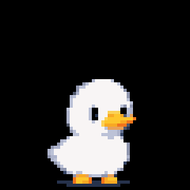
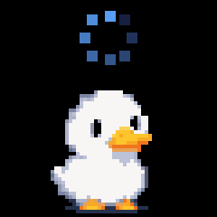

<p align="center">
  
</p>

# holo-duck

holo-duck is a pixel-art duck hologram that sits on your monitor and
shows what GitHub Copilot CLI is doing. Copilot CLI hooks send the
current state to an ESP32-S3 over Wi-Fi. The ESP32 animates the duck on
a 1.3" LCD, and a prism cube makes the image float like a hologram.

## How it works

``` text
Copilot CLI ──hook──▶ curl -4 -d state=working http://duck.local/state ──Wi-Fi──▶ ESP32-S3 ──▶ LCD + prism
```

-   `hooks/duck.json` maps Copilot CLI hook events to duck states. Each
    hook runs `curl` in the background, so it never slows Copilot down.
-   `hooks/duck-watch.sh` covers permission prompts. Copilot fires no
    hook when you answer one, so the script reads the session log. It
    sends `working` when you approve and `idle` when you cancel.
-   The ESP32 joins your Wi-Fi, advertises itself as `duck.local`, and
    accepts `POST /state`. It owns all animation and timeouts, so the
    Mac only sends state names.

## States

|                                                       | State        | Shows when                                                                  |
|-------------------------------------------------------|--------------|-----------------------------------------------------------------------------|
|      | `welcome`    | You launch `copilot` (needs the `.zshrc` wrapper) while the duck rests      |
|     | `thinking`   | You send a prompt                                                           |
|      | `working`    | A tool starts or finishes, or you approve a permission prompt               |
|   | `permission` | Copilot asks for permission or asks you a question                          |
|      | `success`    | Copilot finishes its turn ("your turn", not "the task succeeded")           |
|        | `error`      | Copilot reports an error                                                    |
|         | `idle`       | Nothing is happening, or you cancel a prompt                                |
|     | `sleeping`   | The Copilot session ends, or the duck stays idle for 10 min                 |
|      | `excited`    | A new state wakes the duck from `sleeping`                                  |
|   | `connecting` | The board is joining Wi-Fi or lost it                                       |

The duck returns to `idle` after 5 s of `welcome`, `success` or
`error`, and after 30 min of `thinking`, `working` or `permission`. The
backlight turns off after 20 min of `sleeping`. Any new state turns it
back on.

## Getting started

### You need

-   The Waveshare ESP32-S3-LCD-1.3 kit with case and prism cube
    (SKU 30559), and a USB-C data cable.
-   A Mac with GitHub Copilot CLI and PlatformIO Core
    (`brew install platformio`).
-   A 2.4 GHz Wi-Fi network on the same subnet as your Mac. `duck.local`
    (mDNS) does not work across subnets.

### 1. Add your Wi-Fi details

``` sh
cp firmware/src/secrets.example.h firmware/src/secrets.h
```

Edit `firmware/src/secrets.h` and set `WIFI_SSID` and `WIFI_PASS`. Git
ignores `secrets.h`, so your password stays out of the repo.

### 2. Flash the board

Connect the board over USB-C, then run:

``` sh
cd firmware
pio run -e duck -t upload
```

The duck shows `connecting` until it joins Wi-Fi, then `idle`. Check
the connection from the Mac:

``` sh
curl -4 http://duck.local/status
```

### 3. Install the Copilot hooks

``` sh
mkdir -p ~/.copilot/hooks
cp hooks/duck.json hooks/duck-watch.sh ~/.copilot/hooks/
```

Copy the files; don't symlink them. Hooks load when a Copilot session
starts, so start a new session after you install or change them.

### 4. Optional: wave when Copilot launches

Copilot fires no hook when it launches, so the `welcome` wave needs a
shell wrapper. Add this line to `~/.zshrc`:

``` sh
copilot() { ( curl -4 -s -m 1 -d state=welcome http://duck.local/state >/dev/null 2>&1 & ); command copilot "$@"; }
```

Open a new terminal. `type copilot` should report a shell function.

### 5. Try it

Start `copilot` in a new terminal and send a prompt. The duck waves,
thinks, works, and celebrates when Copilot finishes its turn.

## Test without Copilot

Send any state by hand:

``` sh
curl -4 -d state=working http://duck.local/state
```

Valid states are `idle`, `thinking`, `working`, `permission`,
`success`, `error`, `sleeping`, `excited` and `welcome`. The board
replies `204` for a known state and `400` for anything else.

Always pass `-4`. macOS also asks mDNS for an IPv6 address, which the
ESP32 never answers, so the name lookup stalls for 5 s.

`GET /status` reports uptime, the reason for the last reset, Wi-Fi
drops since boot, and the current state:

``` text
$ curl -4 http://duck.local/status
uptime_s 86400
reset poweron
wifi_drops 0
state idle
```

A small `uptime_s` with `reset poweron` means the board lost power.
`panic`, `task_wdt`, `int_wdt` or `brownout` means a crash or a weak
power supply.

## Troubleshooting

| Problem                               | Fix                                                                                                   |
|---------------------------------------|-------------------------------------------------------------------------------------------------------|
| `curl` cannot find `duck.local`       | Put the board on a 2.4 GHz network on the Mac's subnet. Check `secrets.h`, then flash again.          |
| Requests take about 5 s               | Add `-4` to the `curl` command.                                                                       |
| The duck ignores Copilot              | Start a new Copilot session. Check that both hook files are in `~/.copilot/hooks/`.                   |
| No wave when Copilot launches         | Open a new terminal after you edit `~/.zshrc`. The wave plays only when the duck is idle or sleeping. |
| Upload fails                          | Hold Reset for more than 1 s, then try again.                                                         |
| The screen is dark                    | The backlight turns off after 20 min of `sleeping`. Any new state turns it back on.                   |
| The board restarts when you open the serial monitor | This is expected. Opening the serial port resets the board.                             |

## Known limitations

-   Every Copilot CLI session on the Mac drives the same duck. The last
    message wins, so one session can hide another session's state.
-   `duck-watch.sh` reads Copilot's session log
    (`~/.copilot/session-state/<sessionId>/events.jsonl`), which is not
    a public API. If a Copilot CLI update changes the log, the duck
    stays on `permission` after you answer, until the next hook or the
    30-min timeout. Tested with Copilot CLI 1.0.111.
-   The `welcome` wave needs the zsh wrapper, so it plays only when you
    start `copilot` from a shell that loads `~/.zshrc`.
-   `success` plays at the end of every turn, even when the task failed.

## More detail

[`copilot-duck-build-plan.md`](copilot-duck-build-plan.md) has the full
design: hardware and board gotchas, the animation engine, the hook
mapping, and how each part was verified.
